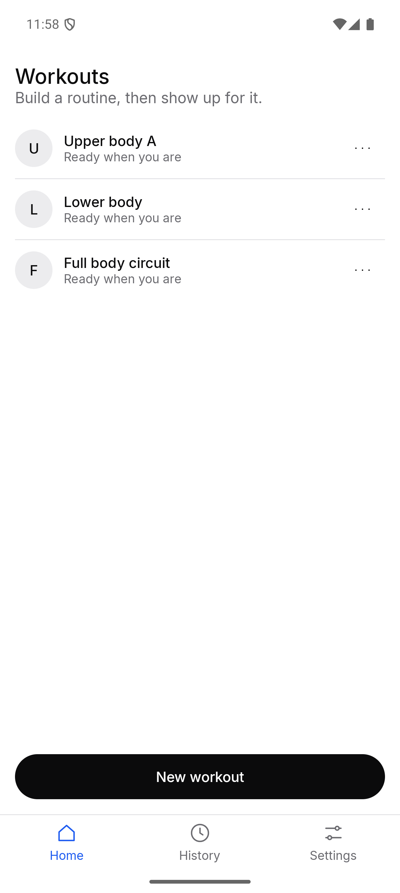
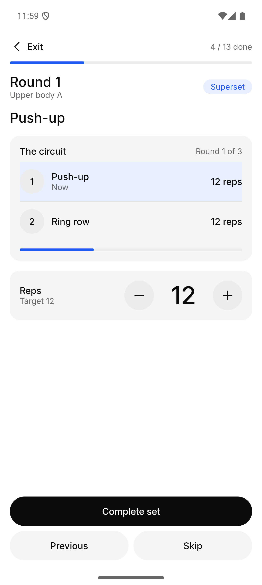
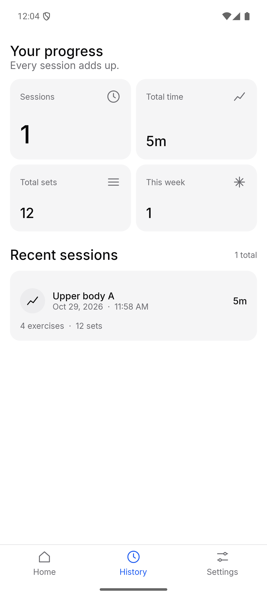
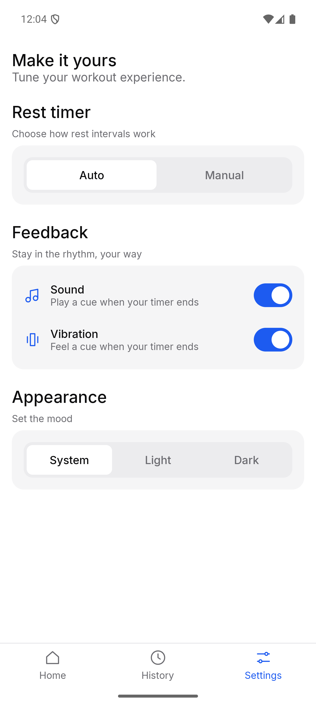
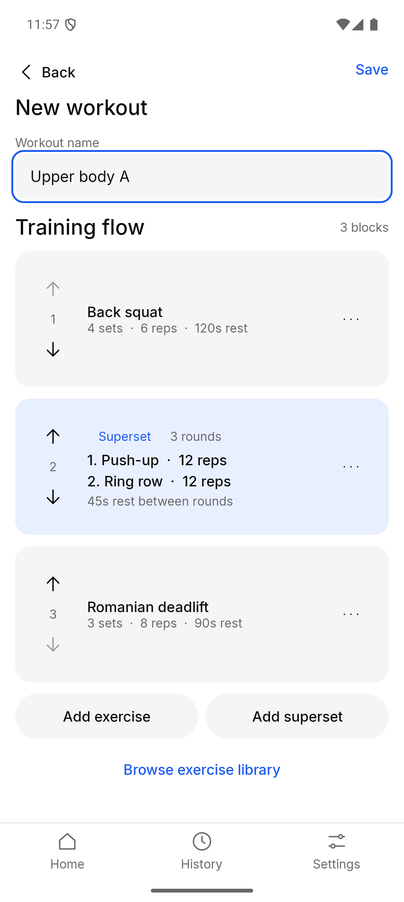
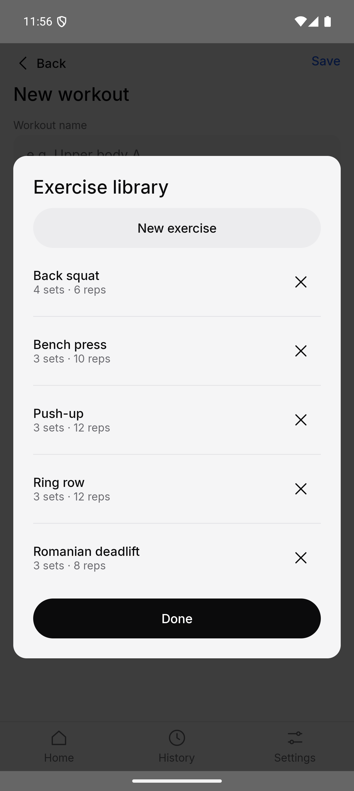
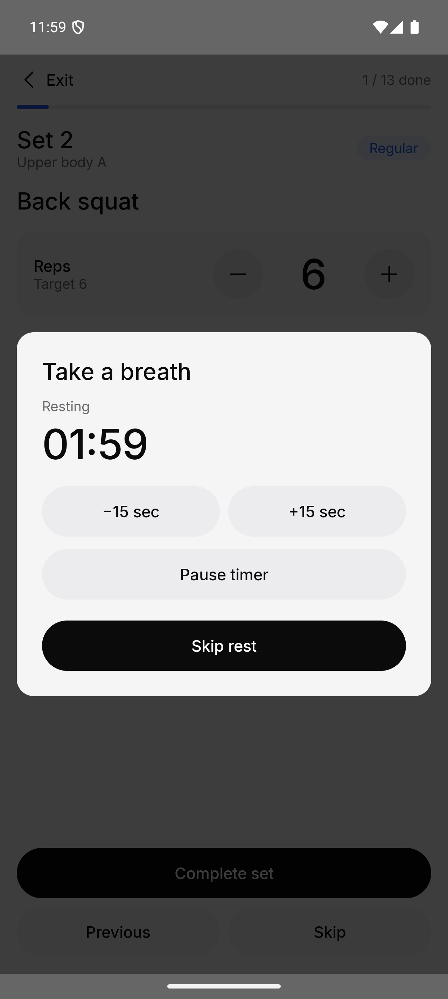
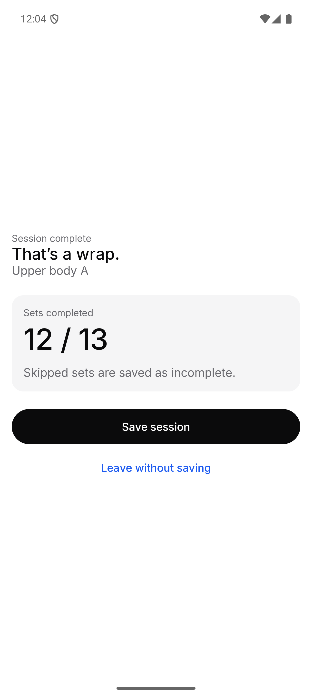
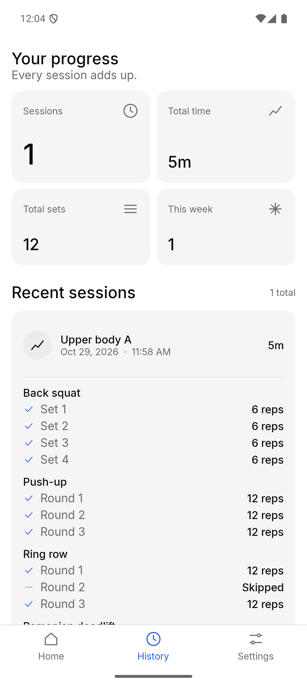

# Tally

**A workout tracker that gets out of your way.**

Build a routine, tap through your sets, and watch your progress add up.
No account, no login, no ads, no subscription. Just open it and train.

  
  
  
  

## Why Tally

- **Super simple.** Three tabs (Home, History, Settings) and one big button while you train. There is nothing to learn.
- **No login.** There is no sign-up and no account. You open the app and start.
- **Completely free.** No paywall, no premium tier, no ads.
- **Private by design.** Everything is stored on your phone. The Android app doesn't even request the internet permission, so your workouts can't leave your device.
- **Light and dark.** Follows your system theme, or pick one yourself.

## How it works

### 1. Build a workout

Tap **New workout** on the Home tab and give it a name. Then add blocks to your training flow:

- **Regular exercise.** Pick an exercise from your library and set the sets, reps and rest time.
- **Superset.** Group several exercises into a circuit and set the number of rounds. Tally cycles through them for you.

Your **exercise library** is yours to fill. Add an exercise once, with a photo and notes if you like, and reuse it in any workout. Each exercise carries default sets, reps and rest, so adding it to a workout takes one tap.

  
  

### 2. Train

Open a workout from Home and the run screen walks you through it, one step at a time:

1. See the current exercise, its photo, and the set or round you are on.
2. Do the set, adjust the reps if you did more or fewer than the target, and tap **Complete set**.
3. The rest timer starts and counts down. When it ends you get a sound and a vibration cue, even if the app is in the background.
4. Repeat until the workout is done.

Rest can start **automatically** after each set, or **manually** when you are ready. You can change this in Settings.

  
  
  

### 3. Save and look back

When you finish, you get a short summary of the sets you completed. **Save session** to keep it, or leave without saving.

The **History** tab shows your totals (sessions, total time, total sets, and sessions this week) and a list of recent sessions. Open one to see every exercise, set by set, with what you planned against what you did. Renaming a workout later won't change your past sessions.

  
  

### 4. Make it yours

The **Settings** tab keeps things short:

| Setting | Options |
| --- | --- |
| Rest timer | Auto or Manual |
| Sound | On or off |
| Vibration | On or off |
| Appearance | System, Light or Dark |

You can also make a copy of a workout or delete it from the menu on its row on Home.

## Tech

Tally is a Kotlin Multiplatform app with a shared Compose Multiplatform UI for **Android** and **iOS**. Data is stored locally with SQLDelight.

| Path | What it is |
| --- | --- |
| [`shared`](./shared/src) | The app: UI, view models, domain logic and local storage, shared across platforms. |
| [`androidApp`](./androidApp) | Android entry point. |
| [`iosApp`](./iosApp) | iOS entry point (open in Xcode). |
| [`dui-lib`](./dui-lib) | DUI-lib, the design system and component library the app is built on (no Material 3). |
| [`dui-sample`](./dui-sample) | A gallery app that shows the theme and every DUI component. |
| [`docs/dui-design-system`](./docs/dui-design-system) | The design tokens and principles. |

### Run it

- Android: `./gradlew :androidApp:assembleDebug`, or use the run configuration in your IDE.
- iOS: open [`iosApp`](./iosApp) in Xcode and run it.
- Component gallery: run the `dui-sample` module.

### Test it

- Android host tests: `./gradlew :shared:testAndroidHostTest`
- iOS simulator tests: `./gradlew :shared:iosSimulatorArm64Test`

## Updating the screenshots

The images above live in [`docs/screenshots`](./docs/screenshots) and are expected as: `home.png`, `editor.png`, `library.png`, `run.png`, `rest.png`, `summary.png`, `history.png`, `session-detail.png` and `settings.png`. Capture them from a real device or emulator (portrait, light theme) and replace the files.
